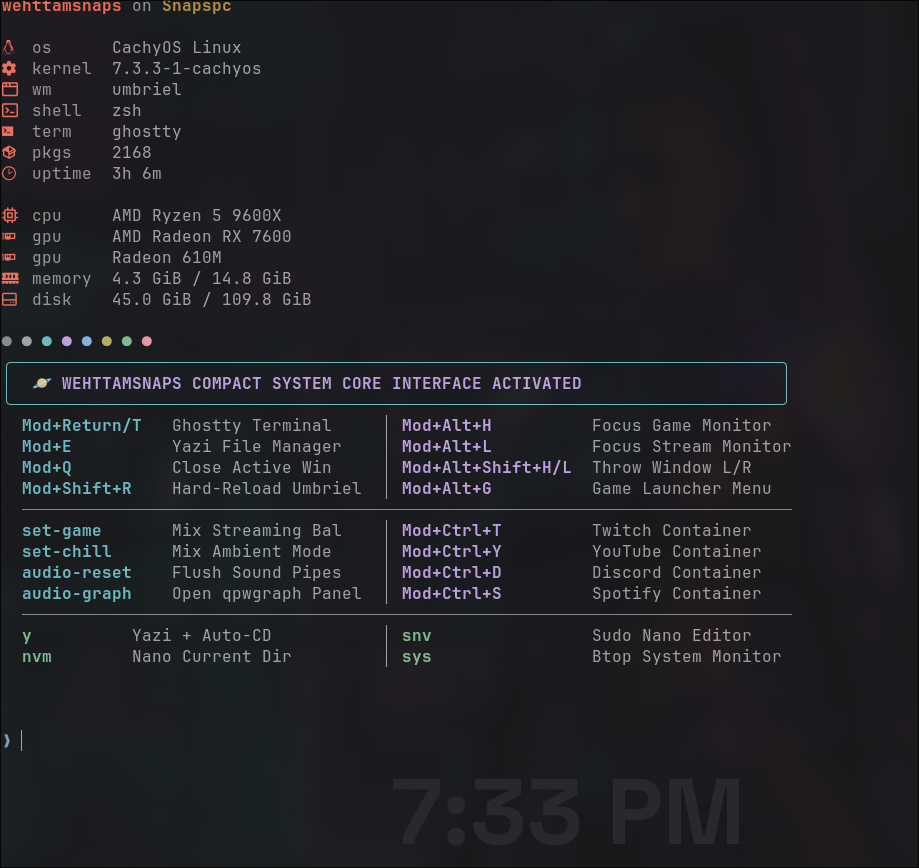
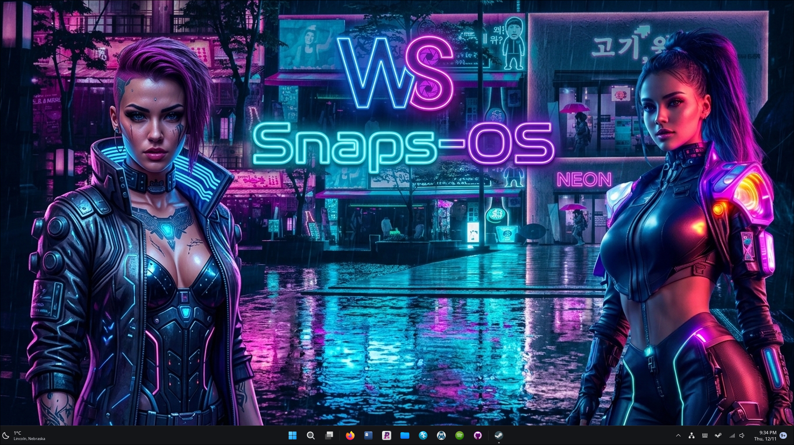
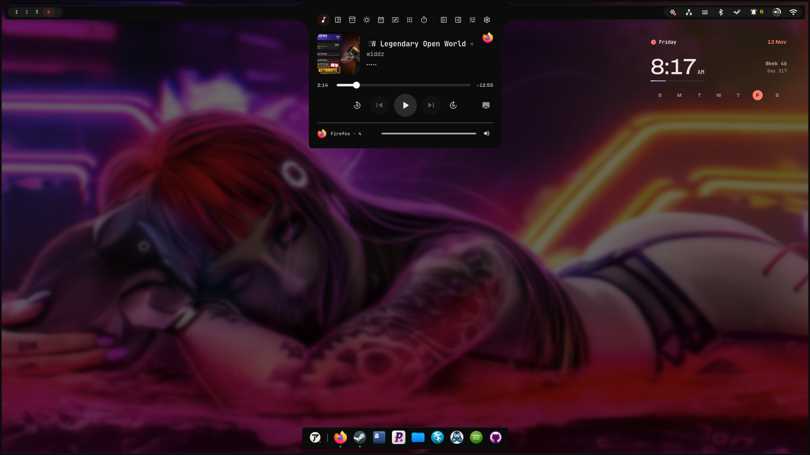
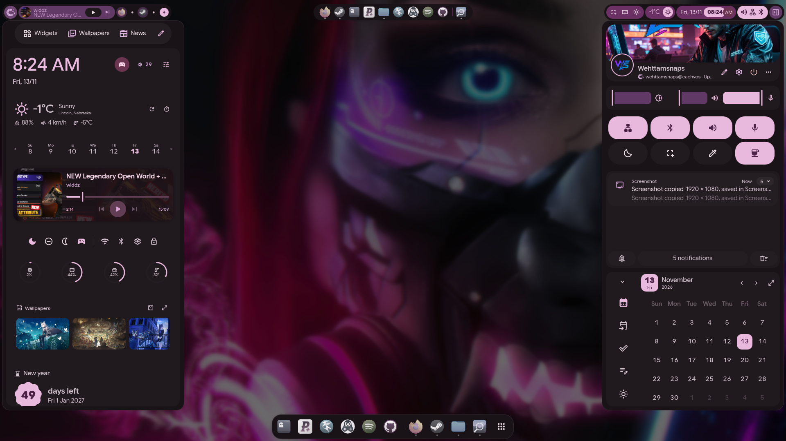

# 🪐 WehttamSnaps-Umbriel

Modular, GPU-accelerated Wayland desktop dotfiles for **CachyOS**, built around the **Umbriel** scrolling compositor, **iNiR / Noctalia** shell, **Ghostty**, and **GNU Stow**.

---

## 📸 Desktop & Terminal Preview



* **Terminal Stack:** Ghostty + Zsh + Fastfetch + custom Cyberpunk MOTD
* **Dynamic Colors:** Live ANSI palette generation synced with desktop wallpapers

---

## 🖥️ Hardware & System Stack

* **OS:** CachyOS Linux (Low-Latency Kernel)
* **Compositor:** Umbriel + iNiR / Noctalia Shell
* **Hardware:** AMD Ryzen 5 9600X | Radeon RX 7600 | 16GB DDR5

---
### 🎩 Fedora 45 Migration & Deployment

For a lower-maintenance, point-release base system with **Linux Kernel 7.2**, run the automated Fedora installer. It configures **RPM Fusion**, swaps in full **FFmpeg + AMD Mesa VA-API codecs**, adds the **Terra** and **Copr** repositories for **Umbriel**, **Ghostty**, and **Yazi**, applies global **RADV** fixes, and links all dotfiles via **GNU Stow**:

```bash
git clone https://github.com ~/Documents/GitHub/WehttamSnaps-Umbriel
cd ~/Documents/GitHub/WehttamSnaps-Umbriel
chmod +x fedora-install.sh && ./fedora-install.sh
```

After the script finishes, complete the **iNiR** shell registration and reboot:

```bash
cd ~/inir && ./setup install   # Select Umbriel when prompted
inir compositor add umbriel && inir compositor sync
umbriel config validate
```

## 🚀 Quick Deployment (GNU Stow)

Clone and install via script or GNU Stow:

```bash
git clone https://github.com ~/Documents/GitHub/WehttamSnaps-Umbriel
cd ~/Documents/GitHub/WehttamSnaps-Umbriel && chmod +x install.sh && ./install.sh
stow -v umbriel mangohud bash zsh
```

---

## 📚 Documentation & Guides

* [🚀 Steam Launch Options & In-Game Graphics Profiles](docs/steam-launch-options.md)
* [📊 MangoHUD Telemetry & Hotkeys](docs/mangohud.md)
* [🛠️ Hardware, Ethernet & Compositor Troubleshooting Log](docs/troubleshooting.md)
* [🔊 Adaptive Sound System (J.A.R.V.I.S. & iDroid)](docs/sound-system.md)
* [🧩 iNiR Desktop Shell Setup & Maintenance](docs/inir.md)
---

## 📜 License

Released under the [MIT License](LICENSE).

---

## 🎨 iNiR Shell Layout Gallery

| Waffle (Taskbar) | iRiS (Island) | Material ii (Sidebars) |
| :---: | :---: | :---: |
|  |  |  |
