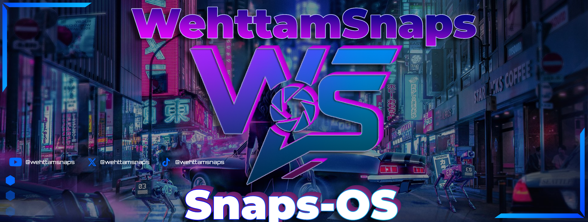
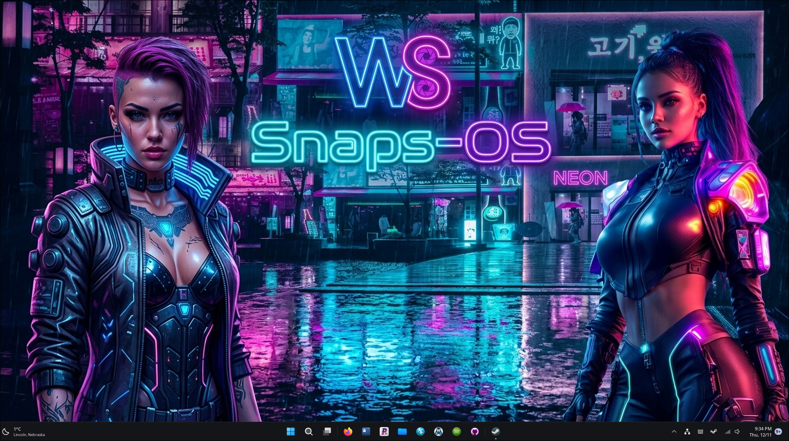
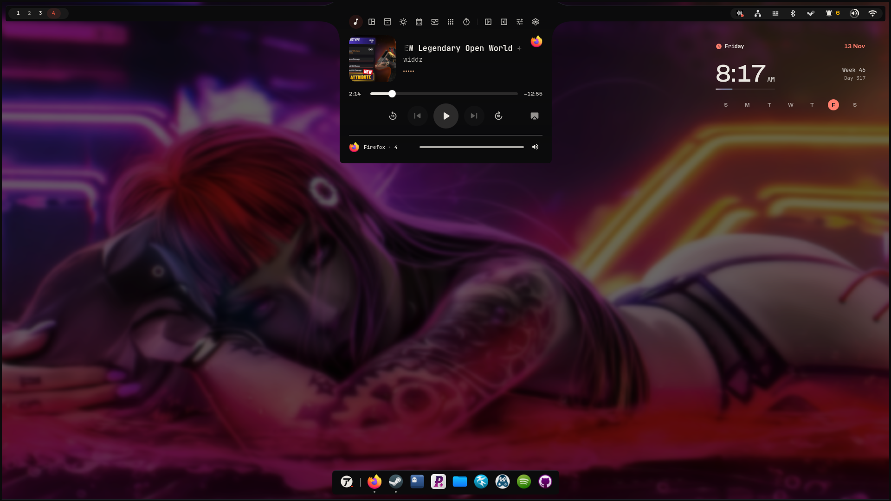
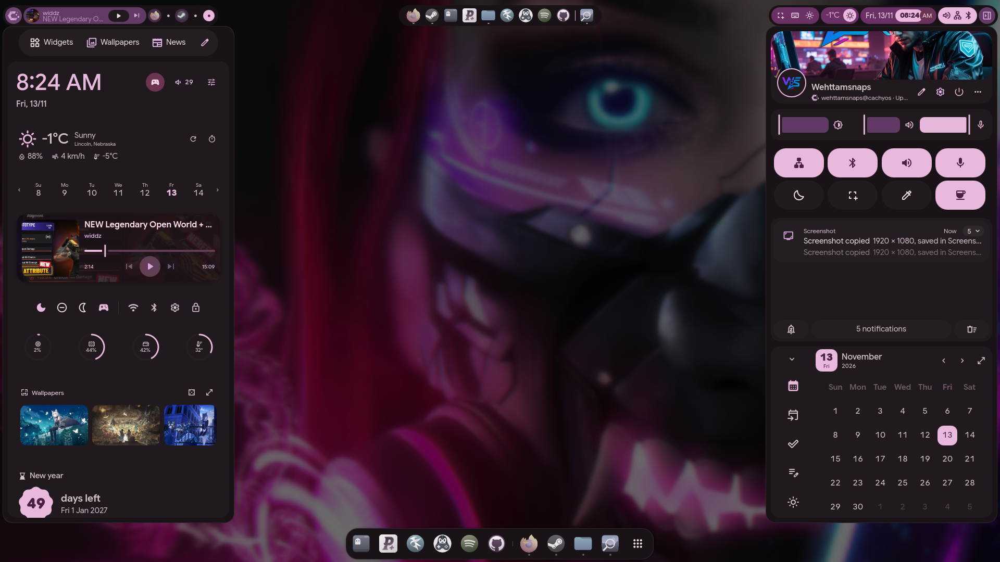

<div align="center">

<a href="https://discord.gg/nTaknDvdUA">
  
</a>

<br><br>


<br><br>



<br><br>


[](https://www.twitch.tv/wehttamsnaps)
[](https://www.youtube.com/@WehttamSnaps)
[](https://github.com/Crowdrocker)

<br>

[**Overview**](#-overview) ·
[**Hardware**](#-hardware) ·
[**Screenshots**](#-screenshots) ·
[**Features**](#-features) ·
[**Gaming**](#-gaming) ·
[**J.A.R.V.I.S.**](#-jarvis) ·
[**Install**](#-install) ·
[**Keybinds**](#-keybinds) ·
[**Docs**](#-documentation) ·
[**Troubleshooting**](#-troubleshooting) ·
[**Credits**](#-credits)

<br>


### Arch Linux configuration optimized for photography, gaming, and content creation.

</div>

---

## ✨ Overview

**Snaps-OS** is a modular **Umbriel** Wayland compositor and **iNiR** Quickshell setup, deployed with **GNU Stow** and optimized for photography, gaming, and content creation on **CachyOS** and **Fedora 45**.

| | |
| :-- | :-- |
| 🤖 **J.A.R.V.I.S. & iDroid** | Context-aware AI voice feedback for system events |
| 🌈 **Shaders & animations** | Community `spectrum` border shaders and `tv-glitch` window transitions |
| 📸 **Photography** | Color-accurate tooling (Darktable, GIMP) for editing and content work |
| 🎮 **Gaming** | RADV, Gamescope, MangoHUD, and Proton GE tuning |
| 🔊 **Audio routing** | PipeWire matrix via qpwgraph and EasyEffects |
| 🧩 **Modular** | Clean GNU Stow symlinks, with nearly everything configurable |

> [!CAUTION]
> **Hey.** This is my personal rice. I put effort into it, but it's not a product. Don't expect hand-holding or stability guarantees. If you're just here because "it looks cool" and have no clue what Niri even is, maybe check out something more beginner-friendly first. Your system, your responsibility.

> [!TIP]
> Almost everything here is configurable: modules, colors, fonts, animations. If something bugs you, there's probably a toggle for it. Hit `Super + ,` for settings before you rage-quit.

---

## 🖥️ Hardware

| Component | Specification |
| :-- | :-- |
| **CPU** | AMD Ryzen 5 9600X (6 cores / 12 threads) |
| **GPU** | XFX Speedster SWFT210 Radeon RX 7600 (8 GB VRAM) |
| **RAM** | 16 GB DDR5 (upgrading to 32 GB dual-channel) |
| **PSU** | EVGA 850W modular |
| **Chassis** | HYTE Y60 (white with black trim, panoramic glass) |
| **Displays** | **Main:** Samsung 4K (configured to 1920×1080 @ 60 Hz)<br>**Left:** native 1080p @ 60 Hz |

---

## 📸 Screenshots

### iNiR shell layouts

| Waffle (taskbar) | iRiS (island) | Material ii (sidebars) |
| :---: | :---: | :---: |
|  |  |  |

---

## 🧩 Features

A shell. Bar at the top, sidebars on the sides, overlays that pop up when you press keys. The usual.

- **Bar**: clock, workspaces, tray, the stuff you expect
- **Sidebars**: left has AI chat and a wallpaper browser; right has quick toggles and a notepad
- **Overview**: workspace grid, adapted for Niri's scrolling model
- **Alt+Tab**: a window switcher that actually works across workspaces
- **Clipboard**: history panel with search (needs `cliphist`)
- **Region tools**: screenshots, screen recording, OCR, reverse image search
- **Wallpaper**: picker with video support; `matugen` pulls colors from whatever you set
- **Theming**: presets like Gruvbox and Catppuccin, or build your own in the theme editor. Fonts are customizable too
- **Settings**: GUI config with search, so you don't have to edit JSON like a caveman
- **GameMode**: fullscreen app? Effects go bye-bye and your games won't stutter
- **Idle**: screen off, lock, and suspend timeouts handled by `swayidle`

### Two flavors, one shell

Can't decide on a look? You don't have to.

- **Material ii**: the OG. Floating bar, sidebars, that Material Design aesthetic.
- **Waffle**: taskbar at the bottom, action center, tray overflow. For the "I kinda miss Windows" crowd.

Press `Mod + Shift + W` to cycle between styles, or go to **Settings → Modules** to mix and match.

### 🔊 Audio routing

System audio is split into isolated virtual lines using PipeWire, so you can control each source independently:

- **Separate channels**: game, browser, Discord, Spotify
- **qpwgraph**: visual routing, similar to VoiceMeeter
- **J.A.R.V.I.S. sounds**: audio notifications for system events

```bash
# Launch the visual patchbay
qpwgraph

# Or use the automated setup
./scripts/audio-setup.sh
```

---

## 🎮 Gaming

Gamemode + Gamescope for performance, Proton GE for compatibility, pre-configured Steam launch options for 16 games, and window rules for mod managers (Vortex, MO2, Wabbajack).

<details>
<summary><b>Supported games (pre-configured)</b></summary>

<br>

- Call of Duty HQ
- Cyberpunk 2077
- Fallout 4
- Far Cry 5
- Ghost Recon Breakpoint
- Marvel's Avengers
- Need for Speed Payback
- Rise of the Tomb Raider
- Shadow of the Tomb Raider
- The First Descendant
- Tom Clancy's The Division 1 & 2
- Warframe
- Watch Dogs 1, 2 & Legion

</details>

### Performance tips

1. **Gamemode**: enabled automatically via launch options
2. **Gamescope**: configured per game
3. **Proton GE**: latest version installed
4. **Mesa**: optimizations pre-configured
5. **Compositor effects**: disabled by the Gaming Mode toggle

See [docs/GAMING.md](docs/GAMING.md) for per-game configurations and troubleshooting.

---

## 🔊 J.A.R.V.I.S.

J.A.R.V.I.S. gives audio feedback for system events:

| Event | Line |
| :-- | :-- |
| **Startup** | "Allow me to introduce myself, I am JARVIS..." |
| **Shutdown** | "Shutting down. Have a good day, Matthew." |
| **Notifications** | "Matthew, you have a notification." |
| **Gaming mode** | "Gaming mode activated. Systems at maximum performance." |
| **Streaming** | "Streaming systems online. All feeds operational." |
| **Warnings** | Temperature alerts and system warnings |

To add or change triggers, edit `scripts/jarvis-manager.sh`.

---

## 🚀 Install

<details open>
<summary><b>CachyOS / Arch Linux</b></summary>

```bash
git clone https://github.com/Crowdrocker/WehttamSnaps-Umbriel ~/Documents/GitHub/WehttamSnaps-Umbriel
cd ~/Documents/GitHub/WehttamSnaps-Umbriel
chmod +x install.sh && ./install.sh
```

</details>

<details>
<summary><b>Fedora 45</b></summary>

```bash
git clone https://github.com/Crowdrocker/WehttamSnaps-Umbriel ~/Documents/GitHub/WehttamSnaps-Umbriel
cd ~/Documents/GitHub/WehttamSnaps-Umbriel
chmod +x fedora-install.sh && ./fedora-install.sh
```

</details>

Not on Arch or Fedora? See [docs/INSTALL.md](docs/INSTALL.md) for manual steps.

### Updating

Already installed? Pull and sync iNiR + Umbriel:

```bash
cd ~/Documents/GitHub/WehttamSnaps-Umbriel && git pull
inir update && inir compositor sync
umbriel config validate && umbriel msg config-reload
```

This syncs QML and configs. Your customizations stay, missing keybinds get added, and hot reload does the rest.

---

## 🎹 Keybinds

The important ones, configured by default:

| Keys | Action |
| :-- | :-- |
| `Mod + Return` | Ghostty terminal |
| `Mod + E` | Yazi file manager |
| `Mod + Q` | Close window |
| `Mod + Space` | iNiR overview |
| `Mod + ,` | iNiR settings |
| `Mod + V` | Clipboard history |
| `Mod + Alt + G` | Game launcher scratchpad |
| `Alt + Shift + P` | Spotify scratchpad |
| `Mod + Alt + S` | Launch Steam (iDroid voice) |
| `Mod + Shift + G` | Toggle Gaming Mode |
| `Mod + Shift + W` | Cycle shell style |
| `Mod + Shift + R` | Reload Umbriel config |
| `Print` | Region / fullscreen / window screenshot |

Full list in [docs/KEYBINDS.md](docs/KEYBINDS.md).

---

## 📚 Documentation

Read these or suffer. Guides live in the [`docs/`](docs/) directory.

| Doc | What's in it |
| :-- | :-- |
| [INSTALL.md](docs/INSTALL.md) | How to install this thing |
| [PACKAGES.md](docs/PACKAGES.md) | Every package the installer uses, by category |
| [KEYBINDS.md](docs/KEYBINDS.md) | Default keyboard shortcuts |
| [IPC.md](docs/IPC.md) | All IPC targets for custom keybindings |
| [SETUP.md](docs/SETUP.md) | How the setup script works, updates, uninstall |
| [LIMITATIONS.md](docs/LIMITATIONS.md) | Known limitations and what doesn't work |
| [GAMING.md](docs/GAMING.md) | Per-game configurations and troubleshooting |
| [steam-launch-options.md](docs/steam-launch-options.md) | Steam launch options and in-game graphics profiles |
| [mangohud.md](docs/mangohud.md) | MangoHUD telemetry and hotkeys |
| [troubleshooting.md](docs/troubleshooting.md) | Hardware, Ethernet, and compositor troubleshooting log |
| [sound-system.md](docs/sound-system.md) | Adaptive sound system (J.A.R.V.I.S. & iDroid) |
| [inir.md](docs/inir.md) | iNiR desktop shell setup and maintenance |

---

## 🛠️ Troubleshooting

Something broke? Shocking. Start here:

```bash
umbriel config validate && umbriel msg config-reload   # validate and reload config
inir compositor status                                 # check compositor state
```

<details>
<summary><b>Shell (ii) misbehaving</b></summary>

```bash
# Check the logs
qs log -c ii

# Restart ii without restarting Niri
qs kill -c ii && qs -c ii

# Nuclear option: reload everything
niri msg action load-config-file
```

</details>

<details>
<summary><b>Niri won't start</b></summary>

```bash
# Check logs
journalctl --user -u niri.service -f

# Validate config
niri validate
```

</details>

<details>
<summary><b>Audio routing not working</b></summary>

```bash
# Restart PipeWire
systemctl --user restart pipewire pipewire-pulse wireplumber

# Re-run audio setup
./scripts/audio-setup.sh
```

</details>

<details>
<summary><b>Gaming performance issues</b></summary>

```bash
# Check Proton version
protonup-qt

# Verify Mesa drivers
vulkaninfo | grep "deviceName"

# Enable performance mode
./scripts/toggle-gamemode.sh on
```

</details>

If you're still stuck, the logs usually tell you what's missing. Usually.

---

## ⚠️ Fair warning

This is my daily driver. It works. Most of the time. I break things when I'm bored.

This fork diverged a lot from the original: different compositor, different features, different bugs. If you want the Hyprland version, check out [end-4's original](https://github.com/end-4/dots-hyprland).

---

## 🙏 Credits

Built using Umbriel, Quickshell, iNiR, and community projects by noctalia-dev, snowarch, end-4, and CachyOS.

- [**end-4**](https://github.com/end-4/dots-hyprland): the original, with ideas worth taking
- [**Quickshell**](https://quickshell.outfoxxed.me/): the framework that makes this possible
- [**snowarch**](https://github.com/snowarch): theming concepts
- [**niri**](https://github.com/YaLTeR/niri): the compositor, by YaLTeR
- [**Umbriel**](https://github.com/noctalia-dev/umbriel): the other compositor iNiR runs on, by the Noctalia team

---

## 📞 Contact

- **Twitch:** [twitch.tv/WehttamSnaps](https://twitch.tv/WehttamSnaps)
- **YouTube:** [youtube.com/@WehttamSnaps](https://youtube.com/@WehttamSnaps)
- **GitHub:** [github.com/Crowdrocker](https://github.com/Crowdrocker)

<div align="center">

Made with ❤️ by WehttamSnaps. If you found this helpful, please consider giving it a ⭐. It helps others discover the project.

<br>

<a href="https://www.star-history.com/?type=date&legend=top-left&repos=Crowdrocker%2FWehttamSnaps-Umbriel">
  <picture>
    <source media="(prefers-color-scheme: dark)" srcset="https://api.star-history.com/chart?repos=Crowdrocker/WehttamSnaps-Umbriel&type=date&theme=dark&legend=top-left" />
    <source media="(prefers-color-scheme: light)" srcset="https://api.star-history.com/chart?repos=Crowdrocker/WehttamSnaps-Umbriel&type=date&legend=top-left" />
    
  </picture>
</a>

</div>
